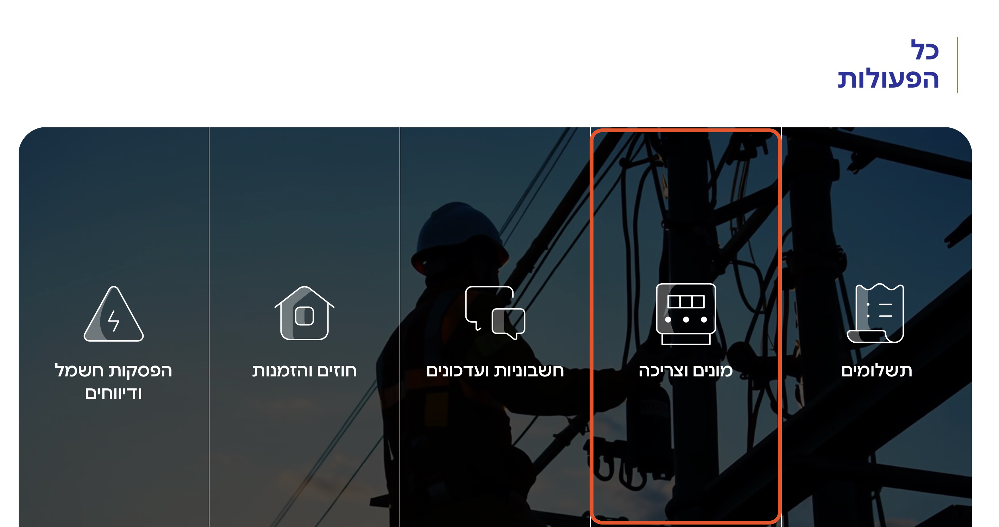
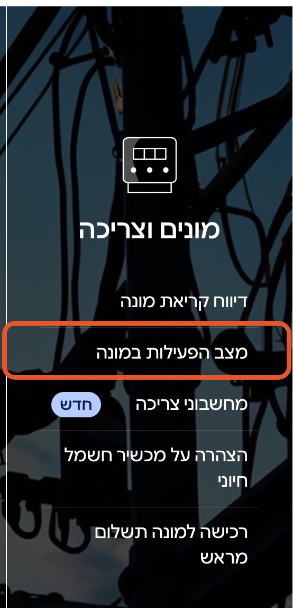
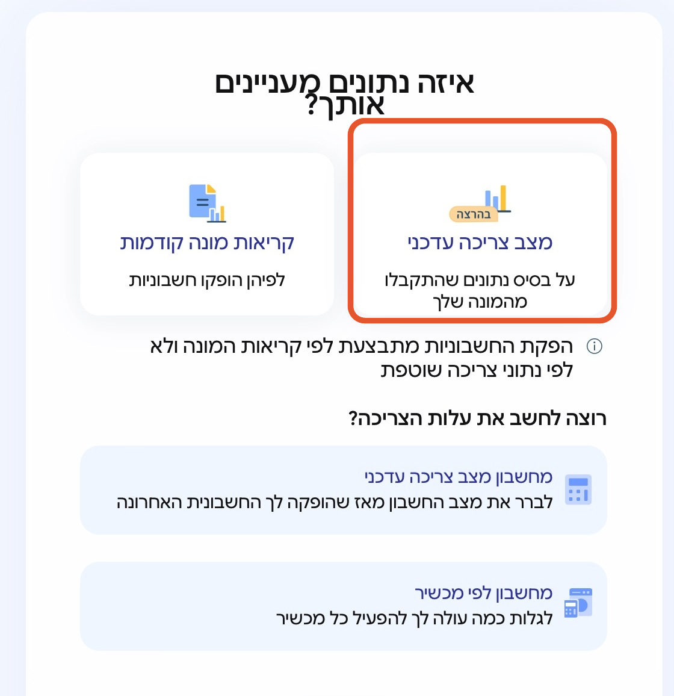
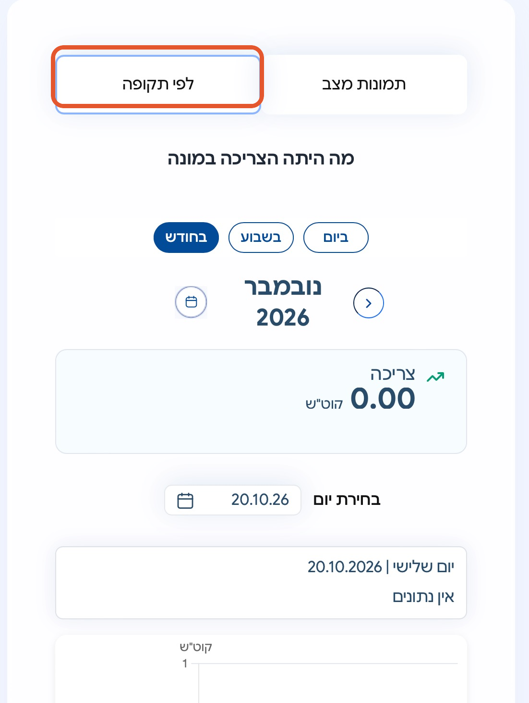
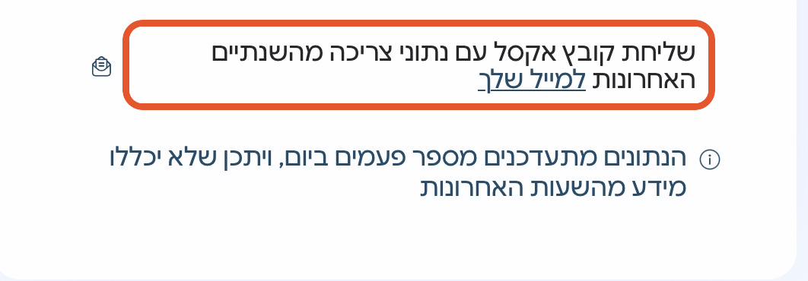

# איך שולפים את קובץ נתוני הצריכה (CSV) מאתר חברת החשמל

מדריך קצר, צעד אחר צעד, להורדת קובץ הצריכה ברמת רבע שעה — זה הקובץ שמעלים למחשבון. נבדק מול האתר בנובמבר 2026.

**מה צריך לפני שמתחילים:** מונה חכם (בלעדיו אין נתוני צריכה לפי שעות) · מספר תעודת זהות של בעל החשבון · גישה לטלפון או למייל הרשומים בחשבון, לקבלת קוד חד־פעמי. כל התהליך לוקח כמה דקות.

## 1. נכנסים לאתר חברת החשמל

פותחים את [iec.co.il](https://www.iec.co.il). בשורת ״פעולות נפוצות״ לוחצים על ״כל הפעולות״.

## 2. בוחרים ״מונים וצריכה״

בעמוד ״כל הפעולות״ לוחצים על האריח ״מונים וצריכה״.

## 3. בוחרים ״מצב הפעילות במונה״

בתפריט ״מונים וצריכה״ לוחצים על ״מצב הפעילות במונה״.

## 4. בוחרים ״מצב צריכה עדכני״

במסך ״איזה נתונים מעניינים אותך?״ לוחצים על הכרטיס ״מצב צריכה עדכני״ (לא ״קריאות מונה קודמות״).

## 5. נפתח מסך הצריכה

מגיעים למסך ״מה היתה הצריכה במונה״, עם לשונית ״לפי תקופה״ ובחירת יום, שבוע או חודש. אם מתבקשים להתחבר — מזינים מספר תעודת זהות ואת הקוד החד־פעמי שנשלח ב־SMS או במייל (את הקוד מקלידים רק באתר של חברת החשמל).

## 6. שולחים את הקובץ למייל

מגללים למטה ולוחצים על ״שליחת קובץ אקסל עם נתוני צריכה **מהשנתיים האחרונות** למייל שלך״. הקובץ נשלח לכתובת המייל הרשומה בחשבון ומגיע בדרך כלל תוך כמה דקות (כדאי לבדוק גם בספאם).

## 7. מורידים מהמייל ומעלים למחשבון

שומרים את הקובץ מהמייל במחשב כמו שהוא, ומעלים אותו למחשבון. הקובץ נקרא בדפדפן שלכם בלבד ולא נשלח לשום שרת.

## הערות

- **CSV או אקסל?** המייל מכיל קובץ נתונים (CSV; לפעמים מגיע כאקסל). אם קיבלתם קובץ `xlsx` והמחשבון מבקש CSV — פותחים ושומרים מחדש בפורמט CSV (קובץ ← שמירה בשם ← CSV).
- **כמה נתונים יש בקובץ?** שנתיים אחורה, מדידה לכל רבע שעה. הנתונים מתעדכנים כמה פעמים ביום, ויכול להיות שהשעות האחרונות עדיין חסרות.
- **אין אפשרות לקבל קובץ?** כנראה שאין מונה חכם. אפשר עדיין לעבור לתוכנית בהנחה קבועה, ומונה חכם מותקן בחינם במסגרת הפריסה הארצית.

---

המדריך מבוסס על אתר חברת החשמל לישראל (iec.co.il), נבדק ב־2 בנובמבר 2026 עם צילומי מסך אמיתיים מהאתר (מספר המונה הושמט מהצילומים). שמות כפתורים ותפריטים משתנים מדי פעם (למשל ״מצב הפעילות במונה״ לעומת ״מצב צריכה עדכני״); אם משהו נראה אחרת, חפשו באזור ״מונים וצריכה״ את האפשרות לקבל קובץ נתוני צריכה למייל.
